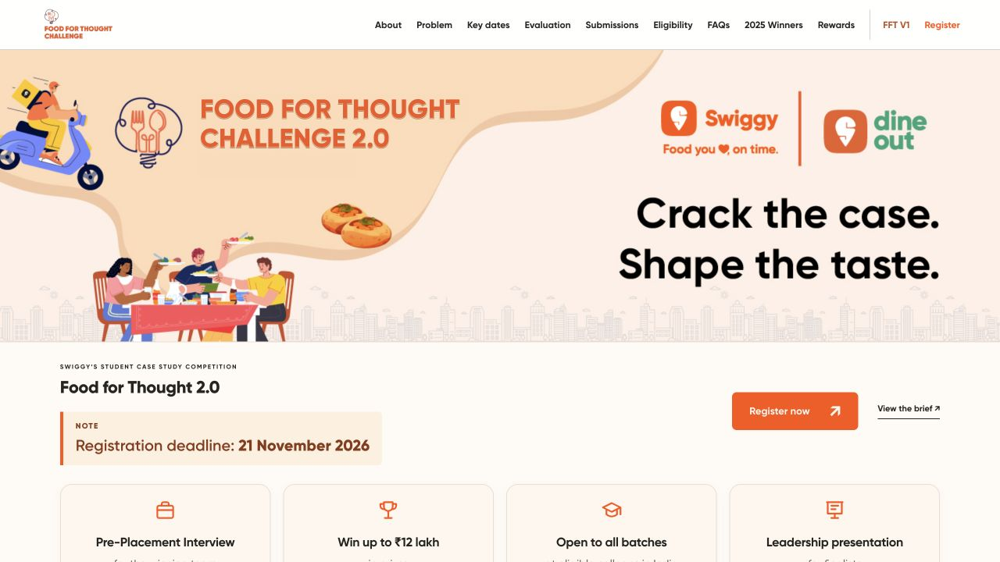

# Food for Thought 2.0

A responsive website for Swiggy’s student case study competition. Food for Thought 2.0 asks: **What should Swiggy build next for India’s college students?**

**[View the live website on Vercel →](https://food-for-thought-edition-02.vercel.app/)**

**Status:** Updated with the latest Food for Thought 2.0 brief. A demo or prototype and its video walkthrough are mandatory. Evaluation is **70% business case / 30% prototype**. The official competition registration form, Student Rewards prerequisite link and Round 1 submission form are available.

**Confirmed registration deadline: 21 November 2026.** The hero displays this as a prominent deadline callout.

**Other dates remain proposed:** submission deadline 15 December 2026 · result of Round 1 on 31 December 2026 · national finale 15 January 2027.



## Project overview

The website refreshes the first edition’s familiar visual identity while keeping the main page compact. It uses the original hero artwork and Gilroy typefaces, with a matching orange CHALLENGE 2.0 wordmark, simple navigation and a light About/Problem section.

The main page includes:

- **Hero highlights:** a compact four-card row ordered as eligibility, up to ₹12 lakh in prizes, the winning team’s PPI, and leadership presentations for finalists.

- **Problem and scope:** validate an unmet student need and connect the solution to Swiggy’s core ecosystem. Covers food ordering/delivery, dining, fulfilment, affordability/rewards/loyalty, campus communities and AI-led improvements; unrelated categories are out of scope.
- **Visible Evaluation Framework and Expected Submission sections:** the supplied guidance, with requested refinements, appears immediately after Key dates, with headings, paragraphs and bullets matching the problem statement format.
- **Business case guidance:** campus insight, proposed solution, user journey, business impact and execution plan; at least one form of campus validation is required.
- **Prototype guidance:** problem–solution fit, core journey, relevant available Swiggy MCP usage and feasibility. The prototype must demonstrate the same idea as the business case.
- **Eligibility:** 2–4 students from the same eligible Indian college, all batches/disciplines; each student may join only one team, every member needs Student Rewards, no membership changes after registration closes, no team-count limit per college.
- **Prizes:** national winner ₹1,50,000 plus a pre-placement interview opportunity; runner-up ₹50,000; top 50 ₹2,000 DineCash per team; all registering students ₹200 DineCash each.
- **Consent and usage:** participants need prior Swiggy approval before publicly publishing, showcasing or sharing submitted prototypes or materials, subject to applicable reviews and approvals.
- **FAQ, downloadable checklist, proposed dates and registration steps.**
- **2025 winners and FFT V1:** retained original artwork, photographs and separate recap. Winners remain before current rewards.

The supplied problem statement appears after About the Competition, including its scope, key questions and exclusions. Requested refinements remove the duplicate justification point and make the mandatory demo/prototype explicit. Evaluation and submission guidance is visible after Key dates. Duplicate evaluation, business case, research, prototype, consent and tips dropdowns and overlapping FAQ answers have been removed.

### Registration behavior

1. Every participant can use the [official Student Rewards link](https://swiggy.onelink.me/888564224/u631l8dw).
2. The confirmed competition registration deadline is **21 November 2026**. Register through the [Food for Thought 2.0 form](https://tally.so/r/6DLy4Y).
3. Returning participants select **Already registered? Submit**, which opens the [submission form](https://tally.so/r/o9RLeO) immediately. The site remembers this browser and changes the hero, navigation and registration CTAs to submission links, while hiding registration steps. A **Need to register a different team?** control restores the registration view.

### Automatic return after registration

On the **registration form** (`6DLy4Y`), enable **Settings → Redirect on completion** and enter:

```text
https://www.foodforthoughtchallenge.in/?registration=complete#submit
```

Tally opens this URL only after the form is submitted. The website remembers the submission view, removes the completion parameter from the address, and updates other open tabs on the same website. Clicking a registration link alone does not change the participant’s state. Use the same canonical website domain so browser storage is shared with the original tab.

This Tally setting must be configured by the registration form owner; adding website code does not configure the external form. The redirect is ready in this source but has not been configured in Tally by this commit.

The remembered state is a browser convenience, not registration or eligibility verification. A different browser/device or cleared storage shows the registration view; the **Already registered? Submit** shortcut restores the submission view. No personal details are stored in the browser, and the public Tally submission form remains directly accessible. There is no OTP, account or backend. If browser storage is blocked, the current visit still switches to submissions. Without JavaScript, both Tally form links remain usable.

Student Rewards signup does **not** register a team for the competition. The website does not collect student data or accept case uploads itself. An entry is submitted only after the student completes the external submission form.


Navigation follows the current page order: About, Problem, Key dates, Evaluation, Submissions, Eligibility, FAQs, 2025 Winners and Rewards, followed by FFT V1 and Register. Eligibility opens its dropdown directly.

## Technology

- HTML for content and structure
- CSS for responsive layouts and visual styling
- Vanilla JavaScript for mobile navigation, edition switching and expandable guidance links
- Static hosting on Vercel

No package installation, build step, backend or environment variables are required to run the website locally.

## Run locally

Requires Python 3 and a modern web browser.

```sh
git clone https://github.com/Jeevannnn20/food-for-thought-edition-02.git
cd food-for-thought-edition-02
python3 -m http.server 4173 --directory dist
```

Open **http://localhost:4173** in your browser. This repository is public and can be cloned without GitHub authentication. Editing the repository requires collaborator write access.

## Repository structure

```text
.
├── README.md
├── vercel.json                  # Static hosting configuration
├── docs/
│   └── website-preview.jpg      # README preview image
└── dist/
    ├── index.html               # Website content and sections
    ├── styles.css               # Styling, fonts and responsive layouts
    ├── app.js                   # Navigation and interactions
    └── assets/                  # Fonts, artwork, photographs and checklist
```

To update content, edit `dist/index.html`. To change the visual design, edit `dist/styles.css`. Interactive behavior is in `dist/app.js`.

## Deployment

The current live preview is hosted at:

**https://food-for-thought-edition-02.vercel.app/**

The included `vercel.json` sets `dist` as the output directory for static hosting. This repository is a source handoff of the current website; automatic deployment from GitHub has not been configured. Pushing a commit to this repository alone will not update the existing live preview.

## Review notes

Submission behavior: completion redirects and the existing-participant shortcut switch the CTAs to submissions. Registration clicks alone leave the registration view intact. Remembered state refreshes on page return and across tabs; the reset control restores registration. No checkbox confirmation or OTP is required.

The linked Tally form currently displays a 31 December registration deadline; the website still uses the supplied 21 November registration / 15 December submission schedule. Resolve this content discrepancy with the form owner before student outreach.

Checked desktop and 390px mobile layouts, horizontal overflow, mobile menu closing after navigation, the Evaluation and Guidelines menus opening the visible sections, FAQs and FFT V1 switching. Verified JavaScript syntax, internal anchors/assets, branding, mandatory prototype wording, 70/30 weights, the confirmed registration deadline and other proposed dates and prize amounts.

The submission form is linked; no case files are stored by this website. Still pending: finale location and confirmation of the remaining proposed dates. No video duration or upload limits have been invented.

The latest proposed dates take precedence over the older registration deadline in the supplied brief. January’s finale is treated as 2027, following the November–December 2026 stages.

## Content and visual references

- [Original Food for Thought Challenge website](https://www.foodforthoughtchallenge.in/)
- [Swiggy’s official 2025 competition recap](https://blog.swiggy.com/news/food-for-thought-challenge-2025-swiggys-first-ever-student-case-study-competition/)

Swiggy names, branding, original artwork, photographs and fonts remain associated with their respective owners. This repository contains the website implementation prepared for review.
