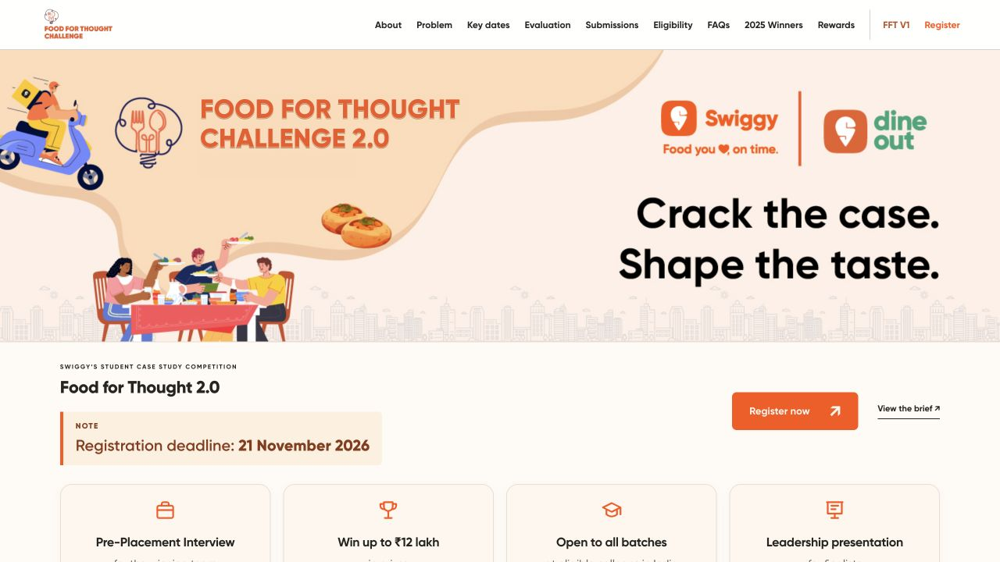

# Food for Thought 2.0

A responsive website for Swiggy’s student case study competition. Food for Thought 2.0 asks: **What should Swiggy build next for India’s college students?**

**[View the live website on Vercel →](https://food-for-thought-edition-02.vercel.app/)**

**Status:** Updated with the latest Food for Thought 2.0 brief. AI use and a prototype video are mandatory. Evaluation is **70% business case / 30% prototype**. The official competition entry URL is pending; the Student Rewards prerequisite link is available.

**Proposed schedule (subject to confirmation):** Launch 7 November 2026 · registration deadline 21 November 2026 · submission deadline 15 December 2026 · evaluation process 31 December 2026 · national finale 15 January 2027. This replaces the earlier 30 October registration deadline.



## Project overview

The website refreshes the first edition’s familiar visual identity while keeping the main page compact. It uses the original hero artwork and Gilroy typefaces, with an integrated second-edition label, simple navigation and a light About/Problem section.

The main page includes:

- **Problem and scope:** validate an unmet student need and connect the solution to Swiggy’s core ecosystem. Covers food ordering/delivery, dining, fulfilment, affordability/rewards/loyalty, campus communities and AI-led improvements; unrelated categories are out of scope.
- **Visible 70/30 evaluation cards:** five-slide business case and short video of a functional or simulated prototype, preferably a web app. The prototype must demonstrate the same business idea; production readiness is not required.
- **Business case guidance:** campus insight, proposed solution, user journey, business impact and execution plan; at least one form of campus validation is required.
- **Prototype guidance:** problem–solution fit, core journey, relevant available Swiggy MCP usage, mandatory AI and its value, feasibility and expected impact.
- **Eligibility:** 2–4 students from the same eligible Indian college, all batches/disciplines; each student may join only one team, every member needs Student Rewards, no membership changes after registration closes, no team-count limit per college.
- **Selection:** AI-assisted screening, human validation of the top 50 and additional flagged/near-cutoff/high-potential cases, then 6–7 in-person finalists and qualitative finale jury criteria.
- **Prizes:** national winner ₹1,50,000 plus a pre-placement interview opportunity; runner-up ₹50,000; top 50 ₹2,000 DineCash per team; all registering students ₹200 DineCash each.
- **Consent and usage:** participants need prior Swiggy approval before publicly publishing, showcasing or sharing submitted prototypes or materials, subject to applicable reviews and approvals.
- **FAQ, downloadable checklist, proposed dates and registration steps.**
- **2025 winners and FFT V1:** retained original artwork, photographs and separate recap. Winners remain before current rewards.

A plain-language, three-step problem explanation follows About the Competition. The submission summary and all six scope areas are visible without opening a dropdown. Longer guidance is expandable, while submission weights, mandatory AI and proposed dates remain visible.

### Registration behavior

1. Every participant can use the [official Student Rewards link](https://swiggy.onelink.me/888564224/u631l8dw).
2. The proposed competition registration deadline is **21 November 2026**. Its official URL is intentionally omitted until supplied; the pending button is disabled.

Student Rewards signup does **not** register a team for the competition. The website does not collect student data or accept case uploads itself. Once supplied, replace the disabled button in `#register` with a link to the official competition platform and update the explanatory text and FAQ.

## Technology

- HTML for content and structure
- CSS for responsive layouts and visual styling
- Vanilla JavaScript for mobile navigation, edition switching, expandable guidance links and the registration information dialog
- Static hosting on Vercel

No package installation, build step, backend or environment variables are required to run the website locally.

## Run locally

Requires Python 3 and a modern web browser.

```sh
git clone https://github.com/Jeevannnn20/food-for-thought-edition-02.git
cd food-for-thought-edition-02
python3 -m http.server 4173 --directory dist
```

Open **http://localhost:4173** in your browser. Because this repository is private, cloning requires an authenticated GitHub account with access.

## Repository structure

```text
.
├── README.md
├── vercel.json                  # Static hosting configuration
├── docs/
│   └── website-preview.jpg      # README preview image
└── dist/
    ├── index.html               # Website content and sections
    ├── styles.css               # Styling, fonts and responsive layouts
    ├── app.js                   # Navigation and interactions
    └── assets/                  # Fonts, artwork, photographs and checklist
```

To update content, edit `dist/index.html`. To change the visual design, edit `dist/styles.css`. Interactive behavior is in `dist/app.js`.

## Deployment

The current live preview is hosted at:

**https://food-for-thought-edition-02.vercel.app/**

The included `vercel.json` sets `dist` as the output directory for static hosting. This repository is a source handoff of the current website; automatic deployment from GitHub has not been configured. Pushing a commit to this repository alone will not update the existing live preview.

## Review notes

Checked desktop and 390px mobile layouts, horizontal overflow, mobile menu closing after navigation, evaluation links opening submission/prototype guidance, FAQs and FFT V1 switching. Verified JavaScript syntax, internal anchors/assets, branding, mandatory AI wording, 70/30 weights, all five proposed dates and prize amounts.

Still pending: the competition registration URL, platform-specific upload instructions, finale location and confirmation of the proposed schedule. No video duration or upload limits have been invented.

The latest proposed dates take precedence over the older registration deadline in the supplied brief. January’s finale is treated as 2027, following the November–December 2026 stages.

## Content and visual references

- [Original Food for Thought Challenge website](https://www.foodforthoughtchallenge.in/)
- [Swiggy’s official 2025 competition recap](https://blog.swiggy.com/news/food-for-thought-challenge-2025-swiggys-first-ever-student-case-study-competition/)

Swiggy names, branding, original artwork, photographs and fonts remain associated with their respective owners. This repository contains the website implementation prepared for review.
